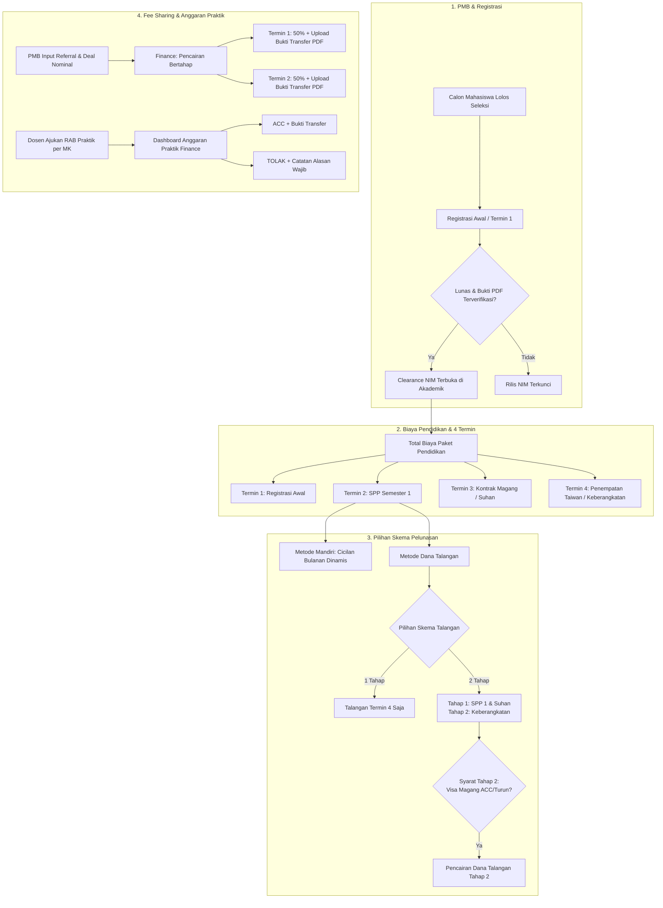

# Analisis Mendalam Alur Bisnis Panel Finance Nusadaya

> **Dokumen Rujukan:** *Transkrip Catatan Rapat Nusadaya* & Audit Kode Sistem Eksisting  
> **Lingkup Analisis:** Panel Finance, Integrasi PMB & Akademik, Database Schema, dan API Backend  
> **Tanggal:** 14 Oktober 2026  

---

## 1. Executive Summary

Berdasarkan hasil notulensi rapat resmi Nusadaya dan audit teknis terhadap implementasi sistem saat ini, ditemukan beberapa ketidaksesuaian mendasar antara alur bisnis operasional riil dengan logika aplikasi yang berjalan. 

Sistem lama masih membawa beberapa asumsi kaku (seperti pembebanan 6 semester langsung di depan, target statis berbasis *browser storage*, talangan yang terkunci 2 tahap, dan fee sharing biner) yang tidak mengakomodasi skema persiapan magang Taiwan dan operasional keuangan terbaru.

Dokumen ini membedah secara mendalam alur bisnis yang berjalan, letak celah (*gap*), serta spesifikasi modifikasi yang harus dilakukan pada **7 poin utama**.

---

## 2. Bedah Alur Bisnis & Gap Analysis

---

### Poin 1: Dashboard Proyeksi Target SPP / PMB / Angkatan

#### A. Alur Bisnis yang Diharapkan (Hasil Rapat)
* Tim Keuangan dan Manajemen memerlukan visibilitas proyeksi target pendapatan yang dirinci ke dalam 3 sumber utama:
  1. **Target PMB**: Total uang masuk dari Registrasi Awal mahasiswa baru per angkatan.
  2. **Target SPP D3 Taiwan**: Target penerimaan SPP Semester 1 mahasiswa program persiapan Taiwan.
  3. **Target SPP D3 Malaysia**: Target penerimaan mahasiswa program Malaysia.
* Setiap target harus dapat ditentukan per **Angkatan (Cohort)** dan tersimpan permanen di database server.
* Dashboard menyajikan matriks perbandingan **Target vs Realisasi (Uang Masuk Riil) vs % Capaian vs Defisit/Surplus**.

#### B. Kondisi Sistem yang Berjalan Saat Ini
* Pada file [FinanceDashboard.tsx](file:///c:/.PROJECT/dashboard-nusadaya/apps/web/src/components/dashboards/FinanceDashboard.tsx):
  * Hanya ada 1 input manual target nominal global yang disimpan di browser via `localStorage` (`nusadaya_finance_projection_target_${selectedCohort}`).
  * Nilai default dipatok `Rp 50.000.000`. Jika staf Finance berganti perangkat atau menghapus cache, target hilang.
  * Tidak ada pembagian target per kategori sumber pendapatan (PMB, SPP Taiwan, SPP Malaysia). Seluruh transaksi masuk dicampuradukkan dalam satu akumulasi.
  * Belum ada tabel database khusus untuk menyimpan pagu target proyeksi keuangan.

#### C. Bagian yang Harus Dimodifikasi
1. **Database Schema (`apps/api/src/db/schema/finance.ts`)**:
   * Tambahkan tabel `finance_projection_targets` (kolom: `cohort`, `category` [`pmb`, `spp_taiwan`, `spp_malaysia`], `targetNominal`, `year`, `updatedBy`, `updatedAt`).
2. **API Routes (`apps/api/src/routes/finance.ts`)**:
   * Tambahkan endpoint `GET /finance/projections?cohort=...` dan `POST /finance/projections` untuk mengambil dan memperbarui target proyeksi multi-kategori per angkatan.
3. **Frontend UI (`FinanceDashboard.tsx`)**:
   * Ganti blok target tunggal dengan **3 Kartu Metrik Proyeksi**:
     - *Proyeksi PMB (Registrasi)*: Realisasi vs Target (Progres Bar + Persentase).
     - *Proyeksi SPP D3 Taiwan*: Realisasi vs Target.
     - *Proyeksi SPP D3 Malaysia*: Realisasi vs Target.
   * Modal dialog untuk mengubah nominal target masing-masing kategori dengan otorisasi role Finance/Superadmin.

---

### Poin 2: Struktur 4 Termin Baku (Registrasi, SPP 1, Kontrak/Suhan, Keberangkatan)

#### A. Alur Bisnis yang Diharapkan (Hasil Rapat)
* Struktur pembiayaan program persiapan kerja/magang luar negeri Nusadaya dibakukan menjadi **4 Termin**:
  * **Termin 1 (Registrasi Awal)**: Biaya daftar ulang / tanda jadi setelah dinyatakan lolos PMB.
  * **Termin 2 (SPP Semester 1)**: Biaya operasional kuliah teori semester 1 di kampus sebelum magang.
  * **Termin 3 (Kontrak Magang / Suhan)**: Biaya proses administrasi legalitas, penerbitan kontrak magang, dan Suhan dari pihak Taiwan.
  * **Termin 4 (Penempatan Magang Taiwan / Keberangkatan)**: Biaya tiket penerbangan internasional, asuransi, visa kerja/magang, dan pelepasan.
* Mahasiswa tidak dibebani tagihan semester 2 hingga 6 di awal, karena semester berikutnya diselesaikan melalui skema pemotongan uang saku magang di luar negeri atau mekanisme talangan.

#### B. Kondisi Sistem yang Berjalan Saat Ini
* Pada file [PembayaranUtamaSection.tsx](file:///c:/.PROJECT/dashboard-nusadaya/apps/web/src/components/panels/finance/PembayaranUtamaSection.tsx):
  * Partisi 1: Berlabel "Registrasi".
  * Partisi 2: Berlabel **"Biaya Perkuliahan (6 Semester)"** yang menampilkan 6 kartu semester (`Semester 1 s.d. 6`) dengan total nominal `curSemesterPerSem * 6`. Ini membingungkan mahasiswa dan staf karena membuat tagihan semester 2–6 terlihat menunggak.
  * Partisi 3: Berlabel "Interview Magang" (bukan "Kontrak Magang / Suhan").
  * Partisi 4: Berlabel "Keberangkatan".
* Skema checklist kelulusan keuangan di backend [finance.ts](file:///c:/.PROJECT/dashboard-nusadaya/apps/api/src/routes/student/finance.ts) masih menghitung semester sebagai blok 6 semester mandiri.

#### C. Bagian yang Harus Dimodifikasi
1. **Frontend UI (`PembayaranUtamaSection.tsx`)**:
   * Ganti arsitektur partisi menjadi **4 Box Termin Baku**:
     - **Termin 1**: Registrasi Awal (Tagihan, Status Lunas, Tanggal Bayar, Bukti PDF).
     - **Termin 2**: SPP Semester 1 (Tagihan, Status Lunas, Tanggal Bayar, Pilihan Cicilan Bulanan Mandiri, Bukti PDF).
     - **Termin 3**: Kontrak Magang / Suhan (Tagihan, Status Lunas, Tanggal Bayar, Bukti PDF).
     - **Termin 4**: Penempatan Magang Taiwan / Keberangkatan (Tagihan, Status Lunas, Tanggal Bayar, Bukti PDF).
   * Hapus tampilan daftar kartu 6 semester dari tampilan utama paket magang Taiwan.
2. **Backend API (`apps/api/src/routes/student/finance.ts`)**:
   * Perbarui kalkulasi progres tagihan dan verifikasi checklist keuangan agar berbasis pada pemenuhan ke-4 termin ini.

---

### Poin 3: Skema Cicilan Bulanan Dinamis (Mandiri)

#### A. Alur Bisnis yang Diharapkan (Hasil Rapat)
* Mahasiswa yang melunasi **Termin 2 (SPP Semester 1)** secara mandiri diberikan keringanan cicilan bulanan selama masa perkuliahan di kampus (sekitar 5–6 bulan, misal Agustus hingga Januari).
* Finance dapat mengatur rencana cicilan bulanan secara dinamis:
  * Menentukan jumlah tenor (misal 3 bulan atau 6 bulan).
  * Menetapkan label bulan/jatuh tempo (contoh: "Cicilan 1 - Agustus", "Cicilan 2 - September").
  * Menentukan nominal per bulan yang fleksibel (tidak harus bernilai sama rata).
  * Menandai status lunas per baris cicilan dan mengunggah bukti transfer PDF per pembayaran.

#### B. Kondisi Sistem yang Berjalan Saat Ini
* Data cicilan menggunakan tabel `finance_semester_installments` yang terikat pada entitas `finance_semesters` (semester 1–6).
* Penginputan cicilan hanya mencatat nomor urut cicilan (*Installment #1, #2*), tanpa tanggal rencana jatuh tempo dan nama periode bulan.
* Tidak ada ringkasan interaktif berapa sisa tagihan SPP Semester 1 terhadap cicilan bulanan yang sudah masuk.

#### C. Bagian yang Harus Dimodifikasi
1. **Database Schema (`finance_semester_installments`)**:
   * Tambahkan kolom `periodeBulan` (varchar/text, misal "Agustus 2026") dan `dueDate` (timestamp).
2. **Frontend UI (`PembayaranUtamaSection.tsx` & Modal Cicilan)**:
   * Sediakan sub-panel **"Jadwal Cicilan Bulanan SPP Semester 1"**.
   * Fitur tambah baris cicilan dengan input: *Periode Bulan*, *Nominal*, *Status Bayar*, *Tanggal Pembayaran*, dan *Upload Bukti PDF*.
   * Kalkulasi dinamis: `Total Tagihan SPP 1 - Akumulasi Cicilan Terbayar = Sisa Tagihan`.

---

### Poin 4: Skema Dana Talangan 1 Tahap vs 2 Tahap

#### A. Alur Bisnis yang Diharapkan (Hasil Rapat)
* Tidak semua mahasiswa mengambil dana talangan penuh:
  * **Dana Talangan 1 Tahap**: Mahasiswa hanya menalangi biaya **Termin 4 (Keberangkatan / Tiket & Visa)**. Biaya registrasi, SPP 1, dan Suhan dibayar secara mandiri.
  * **Dana Talangan 2 Tahap**: Mahasiswa menalangi **Tahap 1 (SPP 1 & Suhan/Kontrak)** dan **Tahap 2 (Keberangkatan)**.
* Plafon pinjaman talangan harus dapat disesuaikan nominalnya secara manual oleh Finance sesuai persetujuan dari mitra pendanaan (koperasi/fintech), bukan dihitung otomatis dari rumus statis sistem.
* **Aturan Kunci**: Pencairan Tahap Akhir (Keberangkatan) **hanya boleh di-ACC jika Visa Magang sudah dinyatakan "Turun" di Panel Magang**.

#### B. Kondisi Sistem yang Berjalan Saat Ini
* Pada [DanaTalanganSection.tsx](file:///c:/.PROJECT/dashboard-nusadaya/apps/web/src/components/panels/finance/DanaTalanganSection.tsx):
  * Pilihan metode pembayaran hanya berupa `"dana_talangan"` tunggal yang langsung menampilkan 2 Tahap secara kaku.
  * Tidak tersedia opsi pemilihan skema **1 Tahap vs 2 Tahap**.
  * Nominal Plafon Tahap 1 dikunci oleh rumus kalkulasi internal semester, sehingga Finance tidak bisa mengubahnya jika ada perbedaan plafon yang disetujui lembaga pembiayaan.
  * Validasi visa sudah ada di backend route, namun UI belum memberikan indikasi visual yang jelas (misal badge atau peringatan bahwa visa belum siap).

#### C. Bagian yang Harus Dimodifikasi
1. **Database Schema (`finance_data`)**:
   * Tambahkan kolom `talanganSkema` (`"1_tahap"` | `"2_tahap"`).
   * Tambahkan kolom `t1PlafonDisetujui` dan `t2PlafonDisetujui` (integer).
2. **Frontend UI (`DanaTalanganSection.tsx`)**:
   * Tambahkan Selector Skema: **"1 Tahap (Keberangkatan Saja)"** vs **"2 Tahap (Bertahap)"**.
   * Jika memilih 1 Tahap: Kartu Tahap 1 dinonaktifkan/disembunyikan, fokus pada plafon keberangkatan.
   * Input nominal plafon yang dapat diedit langsung oleh Finance.
   * Tampilkan status clearance visa: Jika `internshipData.visaReady === false`, tombol ACC/Centang Cair Tahap Keberangkatan dinonaktifkan dengan pesan tooltip *"Menunggu Visa Turun dari Tim Magang"*.

---

### Poin 5: Pencairan Fee Sharing Bertahap (50%) & Upload Bukti Transfer

#### A. Alur Bisnis yang Diharapkan (Hasil Rapat)
* Komisi referral / fee sharing (misal Rp 5.000.000) dicairkan secara bertahap kepada mitra/pemberi referensi:
  * **Termin 1 (50%)**: Dicairkan saat mahasiswa baru selesai registrasi awal dan masuk kuliah.
  * **Termin 2 (50% / Pelunasan)**: Dicairkan saat mahasiswa siap magang / berangkat.
* Setiap termin pencairan **wajib memiliki bukti transfer bank (format PDF)** yang diunggah oleh Finance.
* Role PMB hanya memiliki hak melihat (read-only) daftar dan bukti transfer, sedangkan hak eksekusi pencairan dan upload bukti berada di tangan Finance.

#### B. Kondisi Sistem yang Berjalan Saat Ini
* Pada tabel `fee_share_recipients` dan [TabFeeSharing.tsx](file:///c:/.PROJECT/dashboard-nusadaya/apps/web/src/components/panels/finance/TabFeeSharing.tsx):
  * Status pencairan bersifat biner: `"belum_dibayarkan"` atau `"sudah_dibayarkan"`.
  * Hanya ada 1 slot file bukti (`invoice_file_url`) dan 1 kolom tanggal pencairan (`tanggal_cair`).
  * Jika Finance baru membayar DP 50%, sistem tidak bisa mencatatnya (harus memilih antara tetap dianggap belum bayar atau langsung lunas).

#### C. Bagian yang Harus Dimodifikasi
1. **Database Schema (`fee_share_recipients`)**:
   * Tambahkan kolom termin bertahap:
     - `t1Nominal` (integer), `t1TanggalCair` (timestamp), `t1BuktiTransferUrl` (text), `t1Status` (boolean).
     - `t2Nominal` (integer), `t2TanggalCair` (timestamp), `t2BuktiTransferUrl` (text), `t2Status` (boolean).
     - Perbarui enum `statusPencairan`: `"belum_dibayar"` | `"cair_termin_1"` | `"lunas"`.
2. **API Routes (`apps/api/src/routes/finance.ts`)**:
   * Tambahkan endpoint `/fee-sharing/recipients/:recipientId/disburse-termin` yang menerima nomor termin (1 atau 2), nominal cair, tanggal, dan upload berkas bukti transfer PDF.
3. **Frontend UI (`TabFeeSharing.tsx`)**:
   * Tampilkan tabel rincian dengan kolom ganda:
     - **Pencairan Termin 1 (50%)**: Nominal, Status, Tanggal, Tombol Upload Bukti PDF & Tandai Cair.
     - **Pencairan Termin 2 (50%)**: Nominal, Status, Tanggal, Tombol Upload Bukti PDF & Tandai Cair.
   * Tampilkan badge status pencairan bertingkat (*Belum Cair*, *Cair Termin 1 (50%)*, *Lunas (100%)*).

---

### Poin 6: Form RAB Praktik Dosen & Perbaikan Tombol ACC / Tolak

#### A. Alur Bisnis yang Diharapkan (Hasil Rapat)
* Dosen pengampu mengajukan Rencana Anggaran Biaya (RAB) bahan praktik per mata kuliah vokasi (daftar item, kuantitas, satuan, estimasi harga).
* Tim Finance meninjau pengajuan melalui dashboard:
  * **Tombol ACC (Setujui)**: Finance menyetujui total anggaran dan mengunggah berkas bukti pencairan/transfer dana ke dosen.
  * **Tombol Tolak**: Finance menolak pengajuan dengan **kewajiban menyertakan catatan/alasan penolakan** agar dosen dapat merevisi item belanja.
* Tombol aksi harus responsif, bebas dari masalah freeze/macet, dan memperbarui status secara reaktif tanpa perlu refresh browser penuh.

#### B. Kondisi Sistem yang Berjalan Saat Ini
* Terdapat **kebingungan arsitektur ganda**:
  1. Ada [TabAnggaran.tsx](file:///c:/.PROJECT/dashboard-nusadaya/apps/web/src/components/panels/finance/TabAnggaran.tsx) di dalam panel *detail profil per mahasiswa*, padahal RAB praktik dosen adalah urusan mata kuliah/kelas vokasi, **bukan urusan mahasiswa secara individu**.
  2. Ada [AnggaranPraktikDashboard.tsx](file:///c:/.PROJECT/dashboard-nusadaya/apps/web/src/components/dashboards/finance/AnggaranPraktikDashboard.tsx) di route tersendiri (`/dashboard/finance/anggaran-praktik`).
* Pada `AnggaranPraktikDashboard.tsx`:
  * Alur upload bukti saat approve sempat mengalami kegagalan parsing JSON pada response tertentu.
  * Modal penolakan perlu penguatan validasi agar staf Finance tidak dapat menekan submit tolak tanpa mengisi alasan penolakan.

#### C. Bagian yang Harus Dimodifikasi
1. **Pembersihan Arsitektur**:
   * Hapus komponen `TabAnggaran.tsx` dari panel profil detail mahasiswa agar tidak menimbulkan kerancuan.
   * Jadikan `/dashboard/finance/anggaran-praktik` sebagai satu-satunya pusat kendali RAB Praktik Dosen di panel Finance.
2. **Frontend UI (`AnggaranPraktikDashboard.tsx`)**:
   * Perbaiki interaksi tombol **ACC**: Dialog konfirmasi pencairan yang mendukung unggah bukti PDF transfer sekaligus.
   * Perbaiki interaksi tombol **Tolak**: Dialog alasan penolakan dengan validasi wajib diisi (`min 10 karakter`), mengirim alasan ke backend, dan memperbarui badge menjadi `"Ditolak"`.
   * Perkuat error-handling agar modal tertutup mulus dan tabel langsung me-refresh data tanpa macet.

---

### Poin 7: Format Wajib PDF & Validasi Bayar Syarat Rilis NIM

#### A. Alur Bisnis yang Diharapkan (Hasil Rapat)
* **Standarisasi Dokumen Keuangan**: Semua bukti setor, kuitansi transfer, dan berkas transaksi (Registrasi, Cicilan SPP, Suhan, Keberangkatan, Fee Sharing, RAB Praktik) **wajib berformat PDF** (ekstensi `.pdf`). Format foto sembarangan atau gambar mentah dilarang untuk menjaga kerapian arsip audit keuangan.
* **Clearance Rilis NIM**: Mahasiswa baru **mutlak tidak boleh dirilis NIM-nya** oleh Akademik/PMB jika pembayaran **Termin 1 (Registrasi Awal)** belum diverifikasi LUNAS oleh tim Finance.

#### B. Kondisi Sistem yang Berjalan Saat Ini
* **Clearance Rilis NIM**:
  * Di backend [core.ts (line 1624)](file:///c:/.PROJECT/dashboard-nusadaya/apps/api/src/routes/student/core.ts#L1624), validasi sudah terkunci (`if (!pmbRecord?.isAcc || !finRecord?.registrasiStatus)`).
  * Di frontend [TabDataMahasiswa.tsx](file:///c:/.PROJECT/dashboard-nusadaya/apps/web/src/components/panels/akademik/TabDataMahasiswa.tsx), indikator clearance sudah memantau status PMB dan Finance Registrasi Awal.
* **Format Dokumen PDF**:
  * Pada beberapa input file dan komponen upload di panel Finance, atribut `accept` belum secara ketat dikunci ke `application/pdf`, dan validasi tipe berkas belum memberikan feedback yang seragam kepada pengguna.

#### C. Bagian yang Harus Dimodifikasi
1. **Frontend Upload (`DocumentUpload.tsx`, `TabFeeSharing.tsx`, `AnggaranPraktikDashboard.tsx`)**:
   * Kunci atribut input berkas menjadi `accept=".pdf,application/pdf"`.
   * Tambahkan validasi sisi klien: jika pengguna memilih file selain PDF, sistem langsung menolak dengan toast error: *"Format berkas tidak valid: Seluruh bukti pembayaran wajib berformat PDF (.pdf) dengan ukuran maksimal 5MB."*
2. **Backend Upload Validator (`apps/api/src/modules/file/service/file.service.ts`)**:
   * Tambahkan pengecekan MIME type ketat untuk kategori upload keuangan agar menolak payload non-PDF di tingkat API.

---

## 3. Matriks Perbandingan & Rencana Modifikasi

| No | Modul / Fitur | Alur Berjalan Saat Ini | Alur Target yang Harus Dimodifikasi | Prioritas |
|:---:|---|---|---|:---:|
| **1** | **Dashboard Proyeksi Target** | 1 target global statis di `localStorage` browser | Target tersimpan di DB, breakdown 3 kategori (PMB, SPP Taiwan, SPP Malaysia) per angkatan | **Tinggi** |
| **2** | **Struktur 4 Termin** | Menampilkan 6 semester kaku & "Interview Magang" | 4 Termin Baku: 1. Registrasi, 2. SPP 1, 3. Kontrak/Suhan, 4. Keberangkatan | **Tinggi** |
| **3** | **Cicilan Bulanan Mandiri** | Angka cicilan generik (#1, #2) terikat semester 1-6 | Tabel jadwal cicilan bulanan dinamis untuk SPP Semester 1 (Agustus - Januari) | **Sedang** |
| **4** | **Skema Dana Talangan** | Terkunci fix 2 tahap dengan rumus otomatis kaku | Opsi 1 Tahap (Keberangkatan) vs 2 Tahap, input plafon fleksibel, validasi visa | **Tinggi** |
| **5** | **Pencairan Fee Sharing** | Status biner (belum/sudah) & 1 slot bukti | Pencairan bertahap (Termin 1: 50% & Termin 2: 50%) dengan bukti transfer PDF per termin | **Tinggi** |
| **6** | **RAB Praktik & ACC/Tolak** | Tab ganda di profil mhs; tombol rawan macet | Terpusat di Dashboard Anggaran Praktik, fix tombol ACC + bukti & Tolak + alasan wajib | **Tinggi** |
| **7** | **Validasi PDF & Clearance NIM** | Backend rilis NIM sudah oke; validasi upload belum seragam PDF | Penegakan strict `.pdf` di seluruh slot upload Finance & sinkronisasi clearance NIM | **Sedang** |

---

## 4. Kesimpulan & Langkah Selanjutnya

Alur bisnis operasional Nusadaya memerlukan penyesuaian struktural di Panel Finance agar tidak lagi membebani sistem dengan asumsi 6 semester di muka dan memastikan pencatatan kas, talangan, fee sharing, serta anggaran praktik berjalan akurat sesuai kenyataan di lapangan.

Setelah dokumen analisis ini disetujui, langkah berikutnya adalah menyusun **Implementation Plan** terstruktur per modul untuk dieksekusi secara bertahap tanpa mengganggu data operasional yang sedang berjalan.
