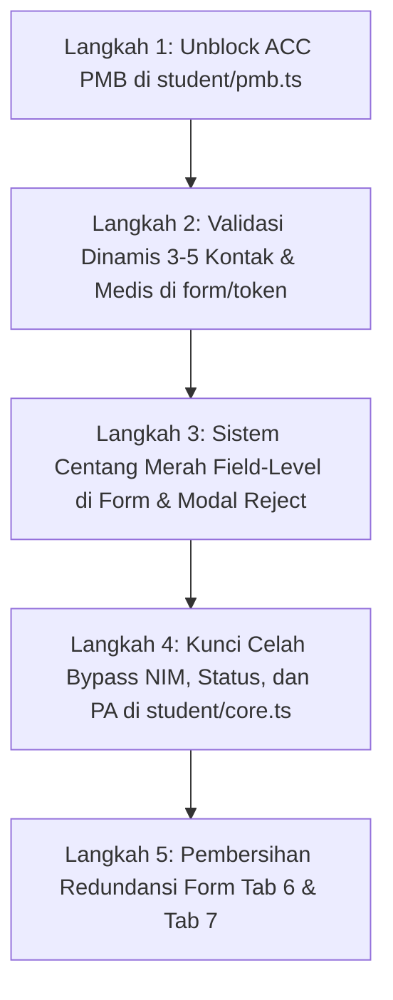

# 📑 Dokumen Analisis Penyesuaian & Modifikasi Alur Panel PMB
**Sistem Dashboard Nusadaya Akademi**  
**Fokus Area:** Modul PMB (Penerimaan Mahasiswa Baru) & Integrasi Lintas Modul (Finance, Akademik, CRM)  
**Status Audit:** Evaluasi Kepatuhan Sistem Berjalan vs Catatan Perbaikan

---

## 📌 Ringkasan Eksekutif

Dokumen ini memuat analisis mendalam per poin terhadap **7 butir catatan perbaikan dan pengembangan sistem** pada alur kerja **Panel PMB**. Analisis ini disusun berdasarkan audit kode sumber aktual pada repositori *dashboard-nusadaya*, mengidentifikasi bagian yang sudah terimplementasi, bagian yang belum sesuai (*gap*), serta rincian teknis yang wajib disesuaikan pada lapisan **Basis Data (Database Schema)**, **Backend API (Elysia.js)**, dan **Antarmuka Pengguna (Frontend React/Next.js)**.

### Matriks Kepatuhan 7 Poin Modifikasi PMB

| No | Poin Catatan Perbaikan | Status Kepatuhan | Tingkat Kesiapan | Urgensi Modifikasi |
|:--:|---|:---:|:---:|:---:|
| 1 | **Tautan Revisi Mandiri (Centang Merah)** | 🟡 Sesuai Sebagian | 75% | Sedang |
| 2 | **Pelacakan Sumber Pendaftar & Fee Sharing di Form Awal** | 🟡 Sesuai Sebagian | 70% | Sedang |
| 3 | **Validasi Wajib 3–5 Kontak Rekomendasi Rekan (RO)** | 🔴 Belum Sesuai | 45% | **Tinggi** |
| 4 | **Kontak Darurat Keluarga & Kelengkapan Biodata** | 🟡 Sesuai Sebagian | 65% | **Tinggi** |
| 5 | **Standarisasi Berkas: Pra-MCU, Pasfoto, SLA & BPJS** | 🔴 Belum Sesuai | 40% | **Kritis (Blocker)** |
| 6 | **Pemisahan Ranah: Migrasi Status Siswa & PA ke Akademik** | 🟡 Sesuai Sebagian | 70% | Sedang |
| 7 | **Batasan Biaya PMB vs Finance & Prasyarat NIM** | 🟢 Hampir Lengkap | 85% | Rendah |

---

## 1. Tautan Revisi Mandiri (Centang Merah)

### 1.1 Catatan Kebutuhan Bisnis
> *Evaluasi link mandiri sekali pakai (one-time use) yang hangus saat submit. Diperbarui agar tautan dapat dibuka kembali khusus memperbaiki field/dokumen yang ditandai revisi (centang merah) oleh admin tanpa harus input ulang dari awal (Segmen 2 & 3).*

### 1.2 Keadaan yang Berjalan Sekarang (*As-Is*)
1. **Pencegahan Token Hangus:**
   * Di backend [`apps/api/src/routes/form-register.ts`](file:///c:/.PROJECT/dashboard-nusadaya/apps/api/src/routes/form-register.ts#L72-L80), token formulir pendaftaran tidak lagi hangus saat pendaftar melakukan submit formulir. Flag `isUsed: true` hanya diset saat admin PMB melakukan persetujuan resmi (*approve*).
   * Pada saat submit ulang, status response kembali ke `PENDING`, dan tautan tetap aktif jika berstatus `REJECTED`.
2. **Pengisian Otomatis (*Pre-Fill*):**
   * Pendaftar tidak perlu mengetik ulang dari awal karena fungsi `mapExistingDataToFormData` di [`apps/web/src/app/form/[token]/page.tsx`](file:///c:/.PROJECT/dashboard-nusadaya/apps/web/src/app/form/[token]/page.tsx#L56-L194) memetakan seluruh data tersimpan kembali ke dalam form state.
3. **Penandaan Stepper & Deep Link:**
   * Stepper pada formulir publik menampilkan ikon X merah (`XCircle`) dan teks *"Perlu Diperbaiki"* untuk nomor tab yang terdaftar dalam array `rejectedTabs`.
   * Banner peringatan revisi per-tab muncul di bagian atas formulir.
   * Tombol *Salin Tautan* di [`apps/web/src/components/dashboards/pmb/TabFormulir.tsx`](file:///c:/.PROJECT/dashboard-nusadaya/apps/web/src/components/dashboards/pmb/TabFormulir.tsx#L61-L69) menyertakan query parameter `?tab=N` untuk mengarahkan pendaftar langsung ke tab pertama yang ditolak.

### 1.3 Analisis Ketidaksesuaian & Masalah (*Gap Analysis*)
* **Revisi Masih di Tingkat Makro (Per-Tab):** Penolakan yang dilakukan admin PMB di [`apps/web/src/app/dashboard/pmb/responses/[id]/page.tsx`](file:///c:/.PROJECT/dashboard-nusadaya/apps/web/src/app/dashboard/pmb/responses/[id]/page.tsx#L42-L57) baru berupa pemilihan Tab 1 sampai Tab 8 secara umum dan satu kotak catatan global (`rejectionNotes`).
* **Belum Ada Centang Merah Field/Dokumen Spesifik:** Calon mahasiswa belum mendapatkan penandaan visual presisi (centang merah / border merah) tepat di samping field tertentu (misal: "Ijazah buram" atau "Format nomor telepon ayah salah"), sehingga mahasiswa harus membaca teks catatan global lalu mencari sendiri letak kesalahannya di dalam tab tersebut.

### 1.4 Rincian Penyesuaian yang Wajib Dilakukan (*To-Be*)
1. **Database Schema:**
   * Tambahkan kolom `rejected_fields` bertipe `jsonb` (array of string, contoh: `["profilePhotoUrl", "docIjazah", "ayahPhone"]`) pada tabel `pmb_form_responses` di [`apps/api/src/db/schema/pmb.ts`](file:///c:/.PROJECT/dashboard-nusadaya/apps/api/src/db/schema/pmb.ts).
2. **Backend API:**
   * Perbarui endpoint `PATCH /pmb/form-responses/:id/reject` di [`apps/api/src/routes/form-register.ts`](file:///c:/.PROJECT/dashboard-nusadaya/apps/api/src/routes/form-register.ts#L385-L413) agar menerima parameter `rejectedFields: string[]` dan menyimpannya ke database.
   * Sertakan field `rejectedFields` pada response `GET /form/:token`.
3. **Frontend Admin Review:**
   * Di modal reject admin [`apps/web/src/app/dashboard/pmb/responses/[id]/page.tsx`](file:///c:/.PROJECT/dashboard-nusadaya/apps/web/src/app/dashboard/pmb/responses/[id]/page.tsx), tambahkan checkbox per-item dokumen dan data utama yang sering bermasalah (Foto Profil, KTP, KK, Ijazah, Data Ayah/Ibu, Data Kesehatan).
4. **Frontend Form Publik:**
   * Di [`apps/web/src/app/form/[token]/page.tsx`](file:///c:/.PROJECT/dashboard-nusadaya/apps/web/src/app/form/[token]/page.tsx), pasang conditional style pada setiap input/file upload: jika field ID ada di dalam `rejectedFields`, berikan border merah terang (`border-rose-500 ring-2 ring-rose-200`), ikon centang silang merah, serta label inline *"Wajib diperbaiki"*.

---

## 2. Pelacakan Sumber Pendaftar & Fee Sharing di Form Awal

### 2.1 Catatan Kebutuhan Bisnis
> *Instruksi pencatatan asal pendaftar (pendamping, sekolah, BKK mitra, kawan) di formulir awal pendaftaran calon mahasiswa. Fitur ini esensial untuk super admin melihat closingan dan otomatis terkoneksi ke fee sharing Finance (Segmen 3 & 4).*

### 2.2 Keadaan yang Berjalan Sekarang (*As-Is*)
1. **Formulir Pendaftaran:**
   * Pada Tab 7 [`apps/web/src/app/form/[token]/page.tsx`](file:///c:/.PROJECT/dashboard-nusadaya/apps/web/src/app/form/[token]/page.tsx#L2370-L2445), telah dibuat seksi *Asal Referral & Rekomendasi Terstruktur* yang mencakup `referralCategory`, `referralInstitutionName`, `referralContactName`, dan `referralContactPhone`.
2. **Integrasi ke Finance:**
   * Pada saat admin PMB menekan tombol *Setujui* di [`apps/api/src/routes/student/core.ts`](file:///c:/.PROJECT/dashboard-nusadaya/apps/api/src/routes/student/core.ts#L340-L375), sistem secara otomatis membuat baris baru di tabel `fee_share_recipients` dengan nominal awal Rp 0 dan status `belum_dibayarkan`.
   * Tim Finance dapat melihat penerima ini di [`apps/web/src/components/panels/finance/TabFeeSharing.tsx`](file:///c:/.PROJECT/dashboard-nusadaya/apps/web/src/components/panels/finance/TabFeeSharing.tsx) untuk menetapkan besaran komisi pencairan.

### 2.3 Analisis Ketidaksesuaian & Masalah (*Gap Analysis*)
* **Beban Input Ganda & Redundansi Form:** Form publik Tab 7 masih mewajibkan pendaftar mengisi kolom legacy secara manual: `rekomendasi`, `timVisit`, `timSosialisasi`, `roReferral`, `mitraSponsor`, dan `koordinator`. Fungsi `validateTab(6)` menolak navigasi jika salah satu kolom ini tidak diisi strip `-`. Hal ini membingungkan calon mahasiswa karena data referral sudah diisi pada bagian terstruktur.
* **Ketiadaan Dasbor Closingan Super Admin:** Belum ada tampilan metrik khusus untuk level pimpinan / Super Admin guna memonitor performa konversi perolehan pendaftar berdasarkan 4 sumber utama (Pendamping, Sekolah, BKK Mitra, dan Kawan).

### 2.4 Rincian Penyesuaian yang Wajib Dilakukan (*To-Be*)
1. **Penyederhanaan Form Tab 7:**
   * Jadikan 4 kategori utama sebagai opsi baku: **1. Pendamping**, **2. Sekolah Mitra**, **3. BKK Mitra**, **4. Kawan / Alumni**, serta opsi **5. Mandiri / Lainnya**.
   * Hapus kewajiban pengisian teks bebas `timVisit`, `timSosialisasi`, `koordinator`, dan `mitraSponsor` pada formulir publik pendaftar; jadikan field tersebut murni data internal kampus yang diisi staf PMB melalui dashboard jika diperlukan.
2. **Dasbor Analitik Super Admin:**
   * Tambahkan visualisasi ringkasan closingan di [`apps/web/src/components/dashboards/PmbDashboard.tsx`](file:///c:/.PROJECT/dashboard-nusadaya/apps/web/src/components/dashboards/PmbDashboard.tsx) yang menampilkan perolehan closing per sumber pendaftar (Jumlah submit, Jumlah ACC, Persentase closing, dan Total kewajiban fee referral terkait).

---

## 3. Validasi Wajib 3–5 Kontak Rekomendasi Rekan (RO)

### 3.1 Catatan Kebutuhan Bisnis
> *Penambahan kolom pertanyaan 'Siapa yang merekomendasikan Anda?' serta kewajiban mengisi 3 s.d. 5 nomor rekomendasi rekan aktif sebelum formulir dapat disubmit untuk verifikasi silang penerima komisi fee (Segmen 4 & 5).*

### 3.2 Keadaan yang Berjalan Sekarang (*As-Is*)
1. **Penyimpanan Kontak Rekan:**
   * Di Tab 8 [`apps/web/src/app/form/[token]/page.tsx`](file:///c:/.PROJECT/dashboard-nusadaya/apps/web/src/app/form/[token]/page.tsx#L2637-L2705), pendaftar diminta mengisi daftar rekan yang memuat Nama Kawan, Nomor WhatsApp, dan Asal Sekolah/Hubungan.
   * Data disimpan di database sebagai JSONB dan dikonversi menjadi entri relasional `student_friend_contacts` saat formulir disetujui.
   * Di CRM [`apps/web/src/components/panels/crm/TabRegistrasiAwal.tsx`](file:///c:/.PROJECT/dashboard-nusadaya/apps/web/src/components/panels/crm/TabRegistrasiAwal.tsx#L55-L111), staf CRM dapat memantau dan mengubah status follow-up calon prospek tersebut (*Belum Dihubungi, Tertarik, dsb.*).

### 3.3 Analisis Ketidaksesuaian & Masalah (*Gap Analysis*)
* **Kuncian Form Kaku (Strict 5 Nomor):** Pada file [`apps/web/src/app/form/[token]/page.tsx`](file:///c:/.PROJECT/dashboard-nusadaya/apps/web/src/app/form/[token]/page.tsx#L728-L748), validasi Tab 8 mengeksekusi perulangan `for (let i = 0; i < 5; i++)` dan **memblokir submit jika salah satu dari 5 kontak kosong**. Padahal catatan instruksi mewajibkan rentang **3 s.d. 5 kontak**. Mahasiswa yang hanya memiliki 3 atau 4 kontak tidak dapat mengirim formulir.
* **Pertanyaan Eksplisit Belum Ada:** Belum ada pertanyaan tunggal yang eksplisit berbunyi *"Siapa yang merekomendasikan Anda?"* yang langsung menjadi acuan data verifikasi silang terhadap penerima komisi fee referral (RO).

### 3.4 Rincian Penyesuaian yang Wajib Dilakukan (*To-Be*)
1. **Frontend Form Publik (`form/[token]/page.tsx`):**
   * **Pertanyaan Utama:** Tambahkan pertanyaan wajib di awal Tab 7/8: *"Siapa yang merekomendasikan Anda mendaftar di Nusadaya Academy?"* dengan pilihan tipe pemberi rekomendasi (Mahasiswa Aktif / Alumni RO / Guru / Brosur / Mandiri).
   * **Dynamic List (3–5 Kontak):** Ubah state `friendContacts` menjadi dinamis. Inisialisasi awal sebanyak 3 baris input wajib. Tambahkan tombol `+ Tambah Kontak Rekan (Maksimal 5)`. Tombol hapus hanya aktif jika jumlah baris lebih dari 3.
   * **Validasi Fleksibel:** Perbarui fungsi `validateTab(7)` agar memvalidasi minimal 3 baris dan maksimal 5 baris. Jika 3 kontak valid telah terisi, formulir diizinkan untuk dikirim.
2. **Backend & Verifikasi Silang:**
   * Di API submit [`apps/api/src/routes/form-register.ts`](file:///c:/.PROJECT/dashboard-nusadaya/apps/api/src/routes/form-register.ts#L132-L138), perbarui sanitasi array `friendContacts` untuk memfilter entri kosong dan memastikan panjang array berada di antara 3 hingga 5.

---

## 4. Kontak Darurat Keluarga & Kelengkapan Biodata

### 4.1 Catatan Kebutuhan Bisnis
> *Penambahan kolom nomor kontak darurat keluarga/orang tua yang wajib diisi untuk penanganan insiden darurat, serta validasi detail riwayat kesehatan, tinggi/berat badan, dan data wali siswa (Segmen 4).*

### 4.2 Keadaan yang Berjalan Sekarang (*As-Is*)
1. **Kontak Darurat:**
   * Tab 8 [`apps/web/src/app/form/[token]/page.tsx`](file:///c:/.PROJECT/dashboard-nusadaya/apps/web/src/app/form/[token]/page.tsx#L2574-L2634) telah memiliki input Nama Kontak Darurat, Nomor WhatsApp, dan Hubungan (Orang Tua, Kakak, Paman, dsb.).
   * Nomor telepon divalidasi dengan format seluler Indonesia (awalan 08/628, 10–15 digit).
   * Data ini ditransfer langsung ke kolom `emergency_contact_*` pada tabel `students`.
2. **Validasi Tinggi & Berat Badan:**
   * Tab 3 memiliki validasi rentang fisik dengan pesan peringatan otomatis jika tinggi badan <150 cm atau >220 cm, serta berat badan <35 kg atau >160 kg.

### 4.3 Analisis Ketidaksesuaian & Masalah (*Gap Analysis*)
* **Field Medis Pra-MCU Tertahan di Database:** Kolom `color_blind_test`, `has_tattoo`, `has_piercing_non_standard`, `has_major_surgery_history`, `has_chronic_disease`, dan `mcu_consent_agreed` telah didefinisikan di skema database [`apps/api/src/db/schema/pmb.ts`](file:///c:/.PROJECT/dashboard-nusadaya/apps/api/src/db/schema/pmb.ts#L204-L210), namun **belum dibuatkan komponen antarmukanya di UI formulir publik [Tab 3]**. Akibatnya, calon mahasiswa tidak mengisi riwayat medis penting ini.
* **Form Wali Membebani Siswa:** Tab 6 mewajibkan seluruh field data wali diisi lengkap (`validateTab(5)`). Untuk calon mahasiswa yang tinggal bersama orang tua kandung, pengisian data wali yang dipaksakan ini menimbulkan redundansi dan kebingungan.
* **Ketiadaan Seksi Kontak Darurat di Profil Admin:** Halaman profil mahasiswa [`apps/web/src/app/dashboard/students/[id]/profile/page.tsx`](file:///c:/.PROJECT/dashboard-nusadaya/apps/web/src/app/dashboard/students/[id]/profile/page.tsx) belum menyajikan kartu khusus penanganan darurat yang menampilkan nomor darurat keluarga secara mencolok.

### 4.4 Rincian Penyesuaian yang Wajib Dilakukan (*To-Be*)
1. **Implementasi UI Tab 3 Form Publik (Kesehatan & Pra-MCU):**
   * Tambahkan dropdown: *Hasil Tes Buta Warna* (Normal / Parsial / Total / Belum Pernah Tes).
   * Tambahkan pilihan radio (Ya / Tidak): *Apakah memiliki tato?*
   * Tambahkan pilihan radio (Ya / Tidak): *Apakah memiliki tindik non-standar?*
   * Tambahkan pilihan radio (Ya / Tidak) + input teks: *Riwayat Operasi Besar*.
   * Tambahkan pilihan radio (Ya / Tidak) + input teks: *Riwayat Penyakit Kronis (Asma, Jantung, Paru, Hepatitis)*.
   * Tambahkan persetujuan wajib: *Kesediaan Mengikuti MCU Resmi Kampus* (Checkbox wajib Ya).
2. **Kondisional Data Wali (Tab 6):**
   * Tambahkan tombol opsi di bagian atas Tab 6: *"Tinggal Bersama Orang Tua Kandung (Wali Sama Dengan Ayah/Ibu)"*. Jika dicentang, sistem otomatis menyalin data orang tua dan mengabaikan validasi wajib yang berulang.
3. **Penyajian Data di Halaman Profil Admin:**
   * Di [`apps/web/src/app/dashboard/students/[id]/profile/page.tsx`](file:///c:/.PROJECT/dashboard-nusadaya/apps/web/src/app/dashboard/students/[id]/profile/page.tsx), tambahkan kartu visual *Kontak Darurat Keluarga* di bagian ringkasan profil dengan tombol pintas WhatsApp/Telepon langsung untuk penanganan insiden darurat.

---

## 5. Standarisasi Berkas: Pra-MCU, Pasfoto, SLA & BPJS

### 5.1 Catatan Kebutuhan Bisnis
> *Pembedaan Pra-MCU pendaftaran vs MCU Full Jakarta; pasfoto formal setengah badan (standar visa disiapkan saat magang); persetujuan dokumen SLA & izin materi promosi wajib di awal; BPJS bersifat opsional agar tidak memblokir pendaftaran; paspor non-locking (Segmen 6).*

### 5.2 Keadaan yang Berjalan Sekarang (*As-Is*)
1. Di checklist PMB [`apps/web/src/components/panels/pmb/TabChecklist.tsx`](file:///c:/.PROJECT/dashboard-nusadaya/apps/web/src/components/panels/pmb/TabChecklist.tsx#L90-L123), berkas BPJS telah berstatus `isOptional: true`.
2. Di backend [`apps/api/src/routes/student/pmb.ts`](file:///c:/.PROJECT/dashboard-nusadaya/apps/api/src/routes/student/pmb.ts#L195-L213), BPJS telah dikeluarkan dari perhitungan checklist wajib persetujuan ACC PMB.

### 5.3 Analisis Ketidaksesuaian & Masalah (*Gap Analysis - KRITIS*)
* 🚨 **Paspor dan MCU Full Masih Mengunci (Locking) ACC PMB:**
  Pada backend [`apps/api/src/routes/student/pmb.ts`](file:///c:/.PROJECT/dashboard-nusadaya/apps/api/src/routes/student/pmb.ts#L206-L212), logika verifikasi ACC PMB berjalan sebagai berikut:
  ```typescript
  // File: apps/api/src/routes/student/pmb.ts (Baris 206-212)
  const requiredChecks = [
      ...
      currentPmb?.docPassportDepan, // ❌ MASIH MENJADI SYARAT MUTLAK
      currentPmb?.docPassportVisa,  // ❌ MASIH MENJADI SYARAT MUTLAK
      currentPmb?.docPreMcu,
      currentPmb?.docMcu,           // ❌ MCU FULL MASIH MENJADI SYARAT MUTLAK
      currentPmb?.docSla,
      currentPmb?.docSertifikasiBahasa,
  ];
  if (!requiredChecks.every(Boolean)) {
      return { success: false, message: "Semua checklist... harus selesai divalidasi sebelum melakukan ACC PMB." };
  }
  ```
  Ini adalah **pelanggaran aturan bisnis yang kritis**. Calon mahasiswa baru yang mendaftar di PMB umumnya belum memiliki paspor dan belum menjalani MCU Full rujukan Jakarta. Kode di atas menyebabkan calon mahasiswa baru **tidak akan pernah bisa di-ACC oleh admin PMB**.
* **Belum Ada Lembar Izin Materi Promosi:** Sistem baru memiliki slot untuk Service Level Agreement (`docSla`), namun dokumen/persetujuan hak guna dokumentasi dan materi promosi kampus belum tersedia.
* **Standarisasi Pasfoto Belum Terpisah:** Di formulir pendaftaran, unggahan foto masih berlabel umum; belum ditegaskan standar pasfoto formal setengah badan untuk keperluan kartu mahasiswa PMB, serta pemisahan pasfoto biometrik visa yang diserahkan nanti di modul Magang.

### 5.4 Rincian Penyesuaian yang Wajib Dilakukan (*To-Be*)
1. **Modifikasi Logika ACC PMB di Backend:**
   * Di [`apps/api/src/routes/student/pmb.ts`](file:///c:/.PROJECT/dashboard-nusadaya/apps/api/src/routes/student/pmb.ts#L196-L215), **keluarkan `docPassportDepan`, `docPassportVisa`, dan `docMcu` dari array `requiredChecks`**.
   * Syarat mutlak kelayakan ACC PMB disederhanakan menjadi:
     * Kelengkapan berkas utama (Formulir, Berkas Lengkap, Input Awal, Follow-up Awal).
     * Berkas identitas PMB (KTP, KK, Ijazah/SKL, Transkrip Nilai, CV, SKBM/SKCK).
     * Berkas kepatuhan awal: **Pra-MCU Skrining Awal (`docPreMcu`)** dan **SLA + Izin Promosi (`docSla`)**.
   * Dokumen Paspor dan MCU Full Jakarta dipindahkan statusnya menjadi dokumen pelengkap di PMB dan menjadi syarat penguncian wajib (*locking requirement*) di **Panel Magang / Internship**.
2. **Pembaruan Label & Item Checklist PMB:**
   * Di [`apps/web/src/components/panels/pmb/TabChecklist.tsx`](file:///c:/.PROJECT/dashboard-nusadaya/apps/web/src/components/panels/pmb/TabChecklist.tsx), ubah label paspor dan MCU Full menjadi berkas lanjutan dengan badge *"Disiapkan saat Program Magang"*.
   * Tambahkan berkas atau perbarui label `docSla` menjadi: *"Dokumen SLA & Izin Penggunaan Materi Promosi / Dokumentasi"*.

---

## 6. Pemisahan Ranah: Migrasi Status Siswa & PA ke Akademik

### 6.1 Catatan Kebutuhan Bisnis
> *Pemisahan batasan wewenang sistem: pengelolaan status keaktifan mahasiswa (aktif, cuti, drop out, undur diri) dan penunjukan Dosen PA dipindahkan sepenuhnya dari PMB ke modul Akademik (Segmen 5).*

### 6.2 Keadaan yang Berjalan Sekarang (*As-Is*)
1. **Pemisahan Endpoint Mandiri:**
   * Endpoint [`PATCH /:id/student-status`](file:///c:/.PROJECT/dashboard-nusadaya/apps/api/src/routes/student/core.ts#L1578-L1586) dan [`PATCH /:id/pa`](file:///c:/.PROJECT/dashboard-nusadaya/apps/api/src/routes/student/core.ts#L1668-L1676) telah dibatasi hak aksesnya: role `pmb` telah dihapus sehingga hanya role `superadmin` dan `akademik` yang diizinkan.
2. **Proteksi UI Profil Siswa:**
   * Pada [`apps/web/src/app/dashboard/students/[id]/profile/page.tsx`](file:///c:/.PROJECT/dashboard-nusadaya/apps/web/src/app/dashboard/students/[id]/profile/page.tsx#L2443-L2511), field dropdown Status Mahasiswa dan Dosen PA berstatus terkunci (`disabled={!isAcademic}`) jika diakses oleh akun non-akademik.

### 6.3 Analisis Ketidaksesuaian & Masalah (*Gap Analysis*)
* **Celah Bypass pada Endpoint Profil Umum:**
  Pada endpoint serbaguna [`PUT /students/:id`](file:///c:/.PROJECT/dashboard-nusadaya/apps/api/src/routes/student/core.ts#L871-L940) dan `PATCH /students/:id`, otorisasi masih mengizinkan role PMB (`hasRole(user, "superadmin", "pmb", "akademik")`), dan skema body masih menerima `studentStatus` dan `paId`. Staf PMB yang memanggil endpoint update umum ini secara tidak sengaja dapat mengubah status aktif mahasiswa atau penugasan PA.
* **Form Tambah Siswa Baru PMB (`students/add`):**
  Di halaman [`apps/web/src/app/dashboard/students/add/page.tsx`](file:///c:/.PROJECT/dashboard-nusadaya/apps/web/src/app/dashboard/students/add/page.tsx#L594-L595), field penunjukan Dosen PA dan pemilihan Status Mahasiswa masih dirender aktif dan dapat dipilih oleh staf PMB.

### 6.4 Rincian Penyesuaian yang Wajib Dilakukan (*To-Be*)
1. **Backend Protection ([`student/core.ts`](file:///c:/.PROJECT/dashboard-nusadaya/apps/api/src/routes/student/core.ts)):**
   * Di dalam handler `PUT /students/:id` dan `PATCH /students/:id`, lakukan filtering: jika pengguna yang melakukan request tidak memiliki role `akademik` atau `superadmin`, abaikan nilai `body.studentStatus` dan `body.paId` (pertahankan nilai yang ada di database).
2. **Frontend PMB Form Tambah/Edit Mahasiswa:**
   * Di [`apps/web/src/app/dashboard/students/add/page.tsx`](file:///c:/.PROJECT/dashboard-nusadaya/apps/web/src/app/dashboard/students/add/page.tsx), sembunyikan dropdown Dosen PA dan status mahasiswa bagi user PMB. Mahasiswa baru yang dibuat otomatis berstatus `"aktif"` dan `paId = null`. Penunjukan Dosen PA dilakukan sepenuhnya oleh tim Akademik di [`TabManajemenMahasiswa.tsx`](file:///c:/.PROJECT/dashboard-nusadaya/apps/web/src/components/panels/akademik/TabManajemenMahasiswa.tsx).

---

## 7. Batasan Biaya PMB vs Finance & Prasyarat NIM

### 7.1 Catatan Kebutuhan Bisnis
> *Tim PMB hanya menginput total biaya pendidikan calon mahasiswa. Rincian pos dan skema termin cicilan dikelola Finance. Penetapan NIM baru diproses setelah pembayaran registrasi awal divalidasi Finance (Segmen 5 & 6).*

### 7.2 Keadaan yang Berjalan Sekarang (*As-Is*)
1. **Pemisahan Ranah Biaya:**
   * Di [`apps/web/src/components/panels/pmb/TabSkemaKeuangan.tsx`](file:///c:/.PROJECT/dashboard-nusadaya/apps/web/src/components/panels/pmb/TabSkemaKeuangan.tsx#L162-L206), staf PMB hanya dapat mengubah field `totalBiaya`. Rincian pos tagihan, cicilan semester, dana talangan, dan biaya seragam ditampilkan secara *read-only* dari data Finance.
   * Master tabel `program_fee_defaults` di database secara otomatis menyuplai pagu biaya standar sesuai sub-program pendaftar saat disetujui.
2. **Clearance Gatekeeper NIM:**
   * Backend [`apps/api/src/routes/student/core.ts`](file:///c:/.PROJECT/dashboard-nusadaya/apps/api/src/routes/student/core.ts#L1616-L1632) pada endpoint `PATCH /:id/nim` memvalidasi bahwa NIM hanya dapat disimpan jika `pmbRecord.isAcc === true` (PMB Clear) dan `financeRecord.registrasiStatus === true` (Registrasi Awal Lunas).
   * Panel Akademik [`apps/web/src/components/panels/akademik/TabDataMahasiswa.tsx`](file:///c:/.PROJECT/dashboard-nusadaya/apps/web/src/components/panels/akademik/TabDataMahasiswa.tsx#L341-L450) menampilkan kartu *Syarat Rilis NIM (Clearance)* dan mengunci input NIM jika salah satu clearance belum terpenuhi.

### 7.3 Analisis Ketidaksesuaian & Masalah (*Gap Analysis*)
* **Celah Bypass NIM di Endpoint Update Siswa Umum:**
  Pada endpoint umum [`PUT /students/:id`](file:///c:/.PROJECT/dashboard-nusadaya/apps/api/src/routes/student/core.ts#L880-L890), terdapat pembaruan `body.nim` tanpa melalui validasi `clearance-status`. Jika staf membuka form edit profil siswa lama dan mengisi NIM, backend akan menyimpannya meskipun registrasi awal di Finance belum lunas.
* **Field NIM di Form Tambah Siswa PMB:**
  Halaman [`apps/web/src/app/dashboard/students/add/page.tsx`](file:///c:/.PROJECT/dashboard-nusadaya/apps/web/src/app/dashboard/students/add/page.tsx) masih menyediakan kolom input manual NIM saat pendaftaran pertama kali, padahal mahasiswa baru belum berhak memperoleh NIM sebelum divalidasi Finance.

### 7.4 Rincian Penyesuaian yang Wajib Dilakukan (*To-Be*)
1. **Pengetatan Validasi NIM di Backend:**
   * Di [`apps/api/src/routes/student/core.ts`](file:///c:/.PROJECT/dashboard-nusadaya/apps/api/src/routes/student/core.ts#L880) pada `PUT /students/:id`: Tambahkan pengecekan clearance yang sama persis dengan `PATCH /:id/nim`. Jika NIM diisi atau diubah sementara siswa belum memenuhi clearance PMB dan Finance, batalkan operasi dan kembalikan galat 400.
2. **Kunci Input NIM di Form Tambah Siswa:**
   * Di [`apps/web/src/app/dashboard/students/add/page.tsx`](file:///c:/.PROJECT/dashboard-nusadaya/apps/web/src/app/dashboard/students/add/page.tsx), nonaktifkan / kunci input NIM dan berikan keterangan: *"NIM diterbitkan di Modul Akademik setelah berkas PMB disetujui dan Registrasi Awal lunas di Finance"*.

---

## 🛠️ Matriks Kebutuhan Modifikasi File

Tabel berikut merangkum seluruh file kode yang harus disentuh untuk menyelesaikan modifikasi di atas:

| Modul / Komponen | File Path | Aksi Modifikasi |
|---|---|---|
| **Backend Schema** | `apps/api/src/db/schema/pmb.ts` | Tambah kolom `rejected_fields` (jsonb). |
| **Backend API PMB** | `apps/api/src/routes/form-register.ts` | Perbarui handler submit (validasi medis Tab 3 & kontak rekan 3–5), simpan `rejectedFields`. |
| **Backend API ACC** | `apps/api/src/routes/student/pmb.ts` | **Buka kuncian ACC PMB**: hapus `docPassportDepan`, `docPassportVisa`, dan `docMcu` dari `requiredChecks`. |
| **Backend API Student** | `apps/api/src/routes/student/core.ts` | Cegah bypass NIM, `studentStatus`, dan `paId` pada endpoint `PUT /students/:id`. |
| **Frontend Form Publik** | `apps/web/src/app/form/[token]/page.tsx` | 1. Tampilkan highlight merah per-field.<br>2. Validasi dinamis 3–5 kontak rekan.<br>3. Render UI riwayat medis Tab 3.<br>4. Ringankan validasi data wali. |
| **Frontend Admin Detail** | `apps/web/src/app/dashboard/pmb/responses/[id]/page.tsx` | Tambahkan checklist pemilihan field/dokumen spesifik yang ditolak pada modal reject. |
| **Frontend PMB Checklist** | `apps/web/src/components/panels/pmb/TabChecklist.tsx` | Ubah status paspor & MCU Full menjadi berkas non-blocking/lanjutan, perbarui label SLA & promosi. |
| **Frontend Student Form** | `apps/web/src/app/dashboard/students/add/page.tsx` | Kunci/sembunyikan input NIM, PA, dan status keaktifan dari form tambah siswa PMB. |

---

## 🎯 Rekomendasi Urutan Pengerjaan (Prioritas Eksekusi)



1. **Sprint 1 (Kritis / Blocker Operasional):**
   * Mengeluarkan paspor dan MCU Full dari syarat wajib ACC PMB di backend `apps/api/src/routes/student/pmb.ts` agar pendaftaran mahasiswa baru tidak terblokir.
   * Mengubah batasan kontak rekan dari tepat 5 menjadi minimal 3 dan maksimal 5 di `apps/web/src/app/form/[token]/page.tsx`.
2. **Sprint 2 (Kelengkapan Data & Validasi Medis):**
   * Memunculkan field medis Pra-MCU (buta warna, tato, operasi, kesediaan MCU) di UI Tab 3 formulir publik.
   * Menghubungkan kolom `rejected_fields` dari modal reject admin ke input merah di form pendaftar.
3. **Sprint 3 (Tata Kelola Wewenang & Proteksi Modul):**
   * Menutup celah bypass NIM, Dosen PA, dan Status Mahasiswa di endpoint `PUT /students/:id` dan form `students/add`.
   * Merapikan form referensi Tab 7 agar tidak lagi membebani pendaftar dengan input ganda.
